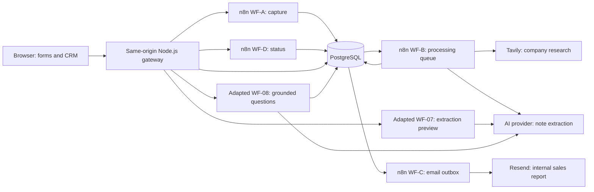

# WBS Trade Fair Assistant

An educational reference implementation for **WBS Coding School students**: capture trade fair conversations, process leads with n8n, research companies, extract training needs with AI, calculate an explainable score, and prepare an internal sales report.

**This repository is not a turnkey deployment package.** Cloning it does not provision a database, activate workflows, configure providers, or produce a working hosted service. Study the implementation and build your own version with your own infrastructure, credentials, data policy, and integration checks.

## Problem and approach

Trade fair notes are often incomplete, scattered, and difficult to turn into consistent follow-up work. This project separates reliable capture from asynchronous enrichment. A conversation can be saved before research or AI finishes; staff can inspect progress, uncertainty, duplicate candidates, and the reasons behind a lead's priority.

The interface is primarily German. This learning guide and the core technical documentation are in English. Original German and Russian engineering records remain available.

## Architecture and data flow

1. The browser signs in to the gateway, which validates requests, controls session scope, and keeps webhook authentication on the server.
2. WF-A validates and persists a submission using a stable submission ID. Retrying the same submission can return its existing receipt; conflicting payloads must be reconciled.
3. Scheduled WF-B claims work, researches the company, extracts supported facts from notes, validates evidence, calculates a deterministic score, and prepares a result plus an email-outbox item.
4. WF-C claims and fences an email send, calls Resend, and records acceptance, failure, or an uncertain outcome. Provider acceptance is not proof of inbox delivery.
5. WF-D supplies authenticated status polling. The dashboard reads a database snapshot through the gateway; CRM actions use separate database functions and retain an audit trail.
6. Adapted WF-07 offers an AI extraction preview requiring human confirmation before capture. Adapted WF-08 answers bounded questions from explicit lead IDs and validates claims against permitted database facts.

## Stack and implementation choices

| Layer | Implementation |
| --- | --- |
| Browser | HTML, CSS, vanilla JavaScript; capture forms and Messe Hub dashboard |
| Gateway | Node.js 22+, native HTTP/crypto/fetch, `pg` for dashboard and CRM access |
| Orchestration | n8n JSON exports; integration evidence uses n8n 2.41.7 |
| Persistence | PostgreSQL; original hosting uses Neon, local integration fixtures use PostgreSQL 16 |
| Research | Tavily HTTP API |
| AI | OpenAI-compatible structured extraction; adapted workflows use native n8n OpenAI nodes. Yuriy's variants use Requesty wiring |
| Email | Resend HTTP API, internal recipient and verified sender required |
| Local verification | Node test runner, disposable Docker databases/n8n, Playwright |

AI output does not directly set WF-B's score. Scoring version 1.0 uses captured fields and note presence: training interest, budget, follow-up, contactability, notes, and website. Scores are 0–100, with HOT ≥70, WARM ≥40, otherwise COLD. Human-confirmed fields from AI-assisted capture can influence those inputs. Research and model output retain uncertainty and evidence for review.

## CRM Dashboard and AI Assistant

The RC3.3 source includes KPI/filter/detail views; virtual lead groups; merge, split, extract, ignore, and constrained undo; and persistent CRM audit history. Grouping preserves original submissions. A separate dashboard key and session scope protect administration; this is shared-key access, without individual staff identities or tenant isolation.

The Lead Assistant is deliberately bounded: 1–20 explicit lead IDs, allowlisted categorical facts, validated citations, and a maximum of 20 model claims. Incomplete coverage is disclosed. AI capture sends notes to an external provider and requires a data-processing decision before real personal data is used.

## Which workflows should I study?

| Family | Location | Meaning |
| --- | --- | --- |
| Production baseline | `workflows/wf-a…wf-d…json` | Exported capture, processing, email, and status pipeline; historical production observations are documented |
| Adapted RC3.3 | `workflows/wf-07…adapted.json`, `wf-08…adapted.json` | Revised extraction/assistant contracts and published-workflow verification; Owner reports G5 production deployment PASS, with G6 functional acceptance pending |
| Yuriy's references | `dashboard/reference-workflows/` | Original variants and dashboard/group/chat companions, with different credentials and trust boundaries |

Do not import all families together or assume their credentials and database contracts are interchangeable. The [workflow guide](docs/WORKFLOW_GUIDE.md) explains the differences.

## Status and learning path

This documentation describes RC3.3 source at `49693b3`, based on candidate `3421a5d`. Source implementation and local test evidence are documented separately from deployment and functional acceptance.

**Production deployment: G5 PASS**, reported by the Owner on **2026-10-27**. WF-07 and WF-08 are published and active with published provenance PASS; the production Neon CRM migration is applied; Gateway RC3.3 is deployed; and the public form and Dashboard are reachable. The deployed image digest and evidence attribution are recorded in the [Owner deployment handover](docs/PROJECT_STATUS.md#owner-deployment-handover--2026-10-27). Codex did not independently access production or repeat these checks.

**Functional acceptance: G6 pending.** AI/CRM end-to-end functionality is not yet fully verified, and Dashboard feature parity with Yuriy's reference is not yet accepted. Deployment success and page reachability do not establish those functional outcomes. No production changes were made for this documentation task.

- [Architecture](docs/ARCHITECTURE.md): components, contracts, persistence, and trust boundaries.
- [Workflow guide](docs/WORKFLOW_GUIDE.md): production, RC3.3, and Yuriy variants; AI and scoring details.
- [Reproduce It Yourself](docs/REPRODUCE_IT_YOURSELF.md): infrastructure, SQL gaps, imports, credentials, and independent verification.
- [Project status matrix](docs/PROJECT_STATUS.md): implemented/tested source, Owner-reported production deployment, and pending functional/parity acceptance.
- [Public-material security review](docs/PUBLIC_SECURITY_REVIEW.md): findings, historical exposure, remediation, and review limits.
- [Documentation map and engineering history](docs/DOCUMENTATION_MAP.md): original baseline, reviews, evidence, and operational plans.

You can study the source without a provider account. Local gateway and deterministic workflow checks use synthetic inputs; real-provider integration requires additional setup and may incur costs. Existing demos are isolated test tools, not deployment recipes.

## Public repository safety

Use synthetic data and independent secrets. Credential IDs/names in workflow exports are references, not usable credentials. Example and test credentials must never be reused for a real deployment. Public history also contains operational metadata and contact addresses; the security report distinguishes these from confirmed secret exposure. Never paste real secrets into HTML, JSON exports, issues, PRs, screenshots, or logs.
